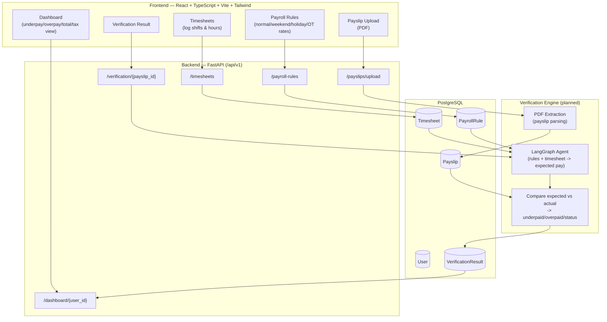

# Payguide (PayGuard AI)

**Motto: Everyone gets paid equally — checking all the time, so you can track your pay.**

Payguide is a payroll verification SaaS application. Employees (or their employers) upload timesheets and payroll rules, and Payguide automatically cross-checks them against uploaded payslips to catch underpayment, overpayment, and award/pay-rule violations — before they slip through unnoticed.

## What the project is about

Payroll errors (missed penalty rates, wrong overtime, incorrect public holiday pay) are common and hard for employees to catch on their own. Payguide's goal is to make pay verification automatic and continuous:

- **Upload payslips (PDF)** — extract the numbers that were actually paid.
- **Log timesheets** — record hours actually worked, per shift.
- **Log payroll rules** — define what *should* be paid per hour type: normal, weekend (Saturday/Sunday), public holiday, overtime, night/morning penalty rates.
- **Verify** — connect timesheets + rules to compute *expected* pay, and compare it against the *actual* pay on the uploaded payslip.
- **Dashboard** — see total pay, underpay, overpay, tax, and remittances at a glance, plus a time-schedule view of exactly when/where underpayment happened.

## Architecture


>>>>>>> efb7211f40e2bc47538eb9cb152a6bf59f8d270b

## Run locally

```bash
npm install
cp .env.example .env   # defaults already point at http://localhost:8000/api/v1
npm run dev
```


## Testing

```bash
npm test
```

Runs the Vitest suite (`src/lib/api.test.ts`, `src/App.test.tsx`) with jsdom and React Testing Library - the central API client's request/error handling, and component-level coverage of the Upload, Dashboard, and Timesheets pages with the backend mocked. Also run:

```bash
npm run lint
npx tsc -b
```

```bash
cd backend
pip install -r requirements.txt
cp .env.example .env
uvicorn app.main:app --reload
```

<<<<<<< HEAD
The FastAPI/PostgreSQL backend lives in [`backend/`](backend/README.md): payroll calculation engine, payslip PDF extraction (with OCR fallback), and the LangGraph verification workflow (deterministic calculation + LLM-generated explanation).
=======
## Progress so far

**Frontend (`src/App.tsx`)** — all 5 core screens are built and routed, currently on mock/hardcoded data:
- `/` Dashboard — expected/actual/difference/hours stat cards, recent verifications table
- `/timesheets` — add-shift form + shift list
- `/rules` — form for the 6 pay rates (normal, Saturday, Sunday, public holiday, overnight, early morning)
- `/upload` — PDF upload for payslips
- `/result` — verification breakdown (gross/tax/deductions/net, underpaid amount, needs-review banner)

**Backend (`backend/app/`)** — FastAPI foundation with real database models and CRUD for the core data:
- Real, working: `User`, `Timesheet`, `PayrollRule` models + services + endpoints (create/list against PostgreSQL)
- Still mocked/stubbed: payslip upload (`payslip_service.mock_upload` — no PDF parsing or file storage yet), verification (`verification_service.mock_verification` — hardcoded result), dashboard summary (`dashboard_service.get_mock_summary`)
- `langgraph_app/` scaffolded but not implemented — `build_graph()` currently raises `NotImplementedError`; this is where the "rules + timesheet → expected pay → compare to payslip" logic will live
- No authentication yet — `user_id` is passed as a raw parameter everywhere

## Next goals

1. **PDF extraction** — parse uploaded payslips into structured data (gross pay, tax, deductions, net, pay period) instead of returning mock metadata.
2. **LangGraph verification engine** — implement `build_graph()` to combine a user's timesheet + payroll rules into an *expected pay* calculation, and compare it against the *extracted* payslip to produce real underpaid/overpaid/needs-review results.
3. **Wire the dashboard to real data** — replace `get_mock_summary` with actual aggregation of verification results: total pay, total underpay, total overpay, tax, remittances, and a time-schedule view flagging exactly which periods were underpaid.
4. **Connect the frontend to the backend** — the frontend currently makes zero API calls; wire all 5 pages to the FastAPI endpoints above.
5. **Authentication** — add real user login/session handling instead of a hardcoded user and raw `user_id` params.
>>>>>>> efb7211f40e2bc47538eb9cb152a6bf59f8d270b
